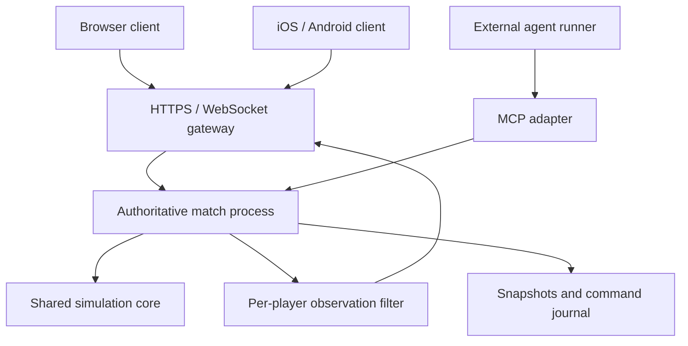

# Lers: technical architecture research

Research date: 24 October 2026. Status: proposed engineering direction for review, not an implemented architecture or a production capacity claim. All project and player-facing language is English.

## 1. Recommendation

Build a browser-first, isometric 2D/2.5D settlement RTS using TypeScript, PixiJS with a WebGL renderer, and an authoritative Node.js match host. Package the shared client for iOS and Android with Capacitor **if physical-device measurements pass**. Keep the simulation independent of graphics, sockets and AI providers. Begin with one Linux host and persistent storage, one isolated process per active online match, and a lightweight lobby/API. Use WebSocket first, filtered state updates and interpolation. Provide built-in bots without model-service dependencies; expose strategic game commands through MCP for optional external agents.

This recommendation optimizes development and operating complexity for a small, noncommercial community. It does not assume unlimited server capacity, nor does it require thousands of users to be viable. Reconsider the renderer if a freely rotating 3D camera is a firm requirement; reconsider the simulation implementation only after representative profiling.

Before committing to a large new simulation implementation, audit the MIT-licensed JSettlers implementation for selectively reusable logic and tests. Its platform/asset assumptions prevent treating it as an off-the-shelf browser/iOS solution; see Section 2.1.

The three most consequential choices are:

1. Server authority rather than mandatory full-world lockstep simulation on every phone.
2. Shared web client rather than separate browser, Swift and Kotlin game implementations.
3. Bounded pathfinding, transport scheduling and local interactions rather than independent unlimited work for each unit.

Sources establish the available capabilities and known constraints. The proposed combinations, budgets and decision gates below are engineering judgments specific to Lers, not claims made by those sources.

## 2. Requirements and evidence boundaries

The project targets familiar The Settlers III-inspired mechanics, actions and menu grouping, with independent code and original assets. Goods travel physically. Economy, recruitment, territorial control and individual soldiers remain meaningful. The intended finished game supports 2–8 player slots, humans/built-in bots/external agents, large maps, 5,000–10,000 soldiers plus civilians per match and 3–4 hour sessions. Browser, iOS and Android are targets. The first complete playable scenario should take 20–30 minutes.

For sizing, use **20,000 total simulated mobile entities** as a proposed stress workload to include civilians alongside 10,000 soldiers. It is not an agreed final population cap. Distinguish total entities, moving entities, fighting entities, player-visible entities, and entities actually drawn in the viewport. All five affect different costs.

Repository evidence: PR #1 contains a dependency-free movement experiment, ownership checks and versioned save/restore. Its recorded local benchmark reports 10,000 units, 1,000 measured ticks after 100 warmup ticks, Node v24.22.1 on Linux x64/AMD EPYC 9V74: p50 0.280 ms, p95 0.470 ms, p99 0.635 ms. This is an earlier project measurement, not a fresh experiment in this study. It excludes navigation, avoidance, economy, combat, visibility, serialization, rendering and network traffic. It provides no proof of final capacity, cross-browser determinism or phone performance.

This research uses primary documentation and first-hand developer/algorithm publications. No production load test, mobile build, provider purchase or fleet benchmark was performed. Current documentation can change; pin exact package/toolchain versions when implementing the prototype.

## 2.1 Existing implementations: do not ignore reusable work

The closest reference found is **JSettlers**, a Java reimplementation of The Settlers III with desktop/Android targets and an MIT license. Its original repository directs readers to a later fork. Playing it requires original game graphics/sound files; MIT licensing of its implementation does not grant rights to those media. [S32] The linked paulwedeck fork is marked archived on 6 July 2026, and its README describes alpha status and broken macOS support. These are explicit maintenance/platform caveats, not evidence that every component is unusable. [S33]

This materially changes the first engineering task: inspect its source/module boundaries, tests and licenses before recreating equivalent logic. Candidate areas to assess include building definitions, transport/task models, navigation, built-in opponents, command handling and replay diagnostics. Verify actual behavior and per-file/dependency provenance; the repository label alone is not a code-quality or rights audit. Preserve required notices for any permitted copied/ported code. No JSettlers code or original assets were imported in this study.

| Existing project | Evidence from its own repository | Useful role for Lers |
| --- | --- | --- |
| JSettlers/original and linked fork | Java, desktop/Android, MIT implementation; original media required; linked fork archived | Closest candidate for a selective logic/test audit |
| Widelands | Settlers II-inspired C++ game with single/multiplayer; GPL v2+ and separately licensed assets | Economy/transport design reference; code reuse requires its licensing terms |
| Return to the Roots | Settlers II reimplementation using original graphics/sound; original game required | Networking/gameplay reference, not a drop-in original-content browser game |
| Stacks browser Settlers III project | Describes a browser-independent simulation, saves and conservation tests; original-media conversion pipeline | Compare its contracts/tests; README claims do not establish scale or redistribution permission |

Widelands documents its GPL v2+ code and mixed asset licenses. Incorporating its code is not the same as independently implementing ideas in the current MIT project. [S34] Return to the Roots explicitly requires original Settlers II data and uses a different game model. [S35] The Stacks project's own README distinguishes implementation licensing from original media rights and says redistribution permission remains unverified. Its existence is useful discovery, not an audited endorsement or performance result. [S36]

**Recommendation:** a bounded audit of JSettlers comes before choosing between (a) a new TypeScript core informed by behavior/tests, (b) selective MIT-compliant ports, or (c) a larger engine reuse/porting effort. Do not assume Java code will run in a browser or on iOS without substantial platform work. A server-only Java core with a web client is another candidate only if the audit shows clean headless boundaries; it would reduce browser-side core reuse and needs a new offline-solo plan. Benchmark a representative extracted subsystem before replacing the proposed TypeScript direction.

This study inspected project documentation and license indicators, not complete source trees or successful builds. A source/build audit is a clearly identified next task, not work already completed.

## 3. Small audience: what it simplifies and what it does not

A few simultaneous games eliminate the need for a distributed game world, multi-region matchmaking, Kubernetes, Redis clusters and automatic fleet scaling at launch. A single European machine can be the initial deployment candidate. Do not provision or buy it until measured match costs are known.

However, one eight-player match with a congested 10,000-soldier battle can be harder than many simple matches. The principal scaling dimensions are:

| Dimension | Main cost | Design response |
| --- | --- | --- |
| Concurrent matches | CPU/RAM multiplied by matches | Isolate matches; bound admissions |
| Mobile entities per match | Movement, neighbors, tasks | Dense data, spatial partition, budgets |
| Dense crowds | Local interaction and blockage | Bound neighbor work and enforce occupancy rules |
| Map area | Terrain, navigation, exploration | Chunking and compact grids |
| Visible activity per player | State encoding and outbound traffic | Visibility-safe interest filtering |
| Viewport contents | Draw calls, fill rate, animation | Batching, culling, visual detail levels |
| Session duration | Leaks, accumulated logs, recovery risk | Four-hour soak, snapshot retention |
| External model decisions | API cost and waiting | Optional runners, budgets, asynchronous orders |

Do not reduce simulation accuracy merely because the camera is elsewhere. Off-screen battles and transport must obey the same rules. Visual simplification is much safer than silently changing outcomes with camera position.

## 4. Renderer and engine comparison

| Candidate | Strength for Lers | Main tradeoff | Recommendation |
| --- | --- | --- | --- |
| TypeScript + PixiJS | Focused accelerated 2D rendering; direct web UI integration | We build RTS systems and content tooling | Preferred fixed-camera isometric path |
| Phaser | Scenes, input and broader game framework; web focus | More engine structure; RTS simulation still custom | Good alternative if those facilities save measurable work |
| Three.js | Direct 3D control, instanced repeated geometry | Animation, asset pipeline and tooling require more work | Prefer if full 3D/rotation is required |
| Godot | Integrated editor, 2D/3D tools and native exports; MIT engine | Web export has its own renderer/language/thread constraints | Strong alternative when native performance/editor workflow dominates |
| Unity | Mature tooling and native/web targets | Additional engine/build complexity for a small web-first project | Viable; not the default without an existing Unity advantage |

PixiJS documentation recommends its WebGL renderer for production and describes WebGPU as still maturing. Use WebGL as the initial compatibility baseline; do not make WebGPU a requirement. Spritesheets and batching are documented optimization paths. [S1–S2] Phaser's own introduction describes a web-first framework with third-party mobile packaging options. [S3] Three.js provides InstancedMesh to reduce draw calls for repeated geometry/materials; it does not itself solve per-soldier animation or game simulation. [S4]

Godot's current stable web-export documentation requires WebAssembly/WebGL 2, uses the Compatibility renderer and states that Godot 4 C# projects cannot currently export to web. It describes single-threaded export and mobile-web caveats. These constraints must be checked against the exact chosen Godot release. Its MIT license is compatible with the project's licensing direction. [S5–S6] Unity 6 documentation lists mobile browser support, so rejecting it with the old blanket claim that Unity web cannot run on phones would be inaccurate. Support is not a performance guarantee. [S7]

### 4.1 Choose the visual contract early

A fixed isometric camera with pan/zoom is a proposed scope choice, not a previously confirmed requirement. This can reproduce the familiar scale and readability with original sprites, terrain tiles and building artwork. Limited discrete rotation would require extra asset directions or 3D assets; arbitrary rotation materially changes the renderer/content decision.

Do not commit to months of sprite production before confirming this choice. Compare one representative 2D scene against a simple instanced 3D scene if rotation is important. Judge time to create content, phone performance, download size and visual clarity, not one isolated desktop FPS number.

### 4.2 Rendering rules

Use atlas-based animation, shared materials, team-color masks and reusable sprites. Cull by world chunks and viewport bounds. Sort depth in local bands/chunks where valid rather than blindly sorting every entity each frame. Profile overlap at building edges; incorrect depth ordering destroys the isometric illusion. Keep UI updates separate from animation: a reactive UI component for every soldier is unnecessary.

No rigid-body physics engine is needed for normal soldiers or carriers. Damage, reach and occupancy belong to game rules; deaths, dust, smoke and projectiles can often use cheaper presentation effects. Restrict expensive shadows, transparency layers and postprocessing on mobile. Provide a configurable render-resolution cap instead of always drawing at full device pixel ratio.

A raw texture example: one unit type with 16 directions × 8 frames × 128 × 128 RGBA pixels consumes 8 MiB before atlas waste/mipmaps. Twenty types consume 160 MiB raw; full mipmaps add roughly one third. Compressed downloads are not equivalent to decoded GPU memory. Start with a smaller original asset set and prove the pipeline before multiplying factions, skins and animation states.

## 5. Multiplayer: authority versus lockstep

| Approach | Benefit | Cost for this project |
| --- | --- | --- |
| Deterministic lockstep | Send ordered commands rather than every entity's state | Every client runs the world and must reproduce identical results |
| Authoritative server + filtered updates | Central rules/visibility; clients can be lighter; reconnect from server state | Server computes the world and sends state; requires bandwidth control |
| Player-hosted peer/relay model | Can reduce central compute | Host lifetime, mobile suspension, trust, connection recovery and possibly relay operations |

Lockstep is a proven RTS/simulation technique. Fiedler explains its input-based bandwidth advantage and strict determinism requirement. Factorio's developers describe actual determinism work involving sort order and mathematical functions; a seed and fixed timestep alone are insufficient. [S8–S9] The browser being fast enough does not remove these requirements.

**Recommendation:** server authority for online play, with clients receiving only authorized observations. Do not make weaker phones simulate all hidden entities. A slow client should degrade its presentation or reconnect, not force everyone else's machine to slow down. This is an engineering choice for Lers, not a claim that authoritative networking is always superior.

A common simulation core is still useful for offline solo and testing. It does not require online clients to run that core in lockstep. Server replays need controlled execution as well: prefer fixed-point/integer authoritative state, stable iteration/tie-breaking, seeded random streams and tick-indexed decisions. Save all relevant scheduler/RNG state. Keep cosmetic randomness separate.

### 5.1 Match structure

One simulation owns one match's authoritative state. Do not divide a single battlefield across machines initially. Isolate each active match in a child process for crash containment and CPU accounting; use a small supervisor/gateway to route sessions. A worker per match is also viable, but one runaway room in an unpartitioned event loop must not freeze lobby traffic and other matches. Node worker threads support parallel CPU-bound JavaScript; they do not make a single loop automatically parallel. [S10]

Client requests become validated commands with match ID, connection-bound identity, command ID, sequence and optional state/tick preconditions. The server assigns application order and tick. Never trust client resource counts, damage, ownership, visibility or elapsed time. Limit group size, payload size and command frequency. Reject invalid requests atomically. UI selection feedback and placement previews can be immediate while execution awaits acknowledgement.

### 5.2 Backend library choice

Colyseus offers rooms, server-mutated state, property-level binary patches, reconnection facilities and client-specific StateView filtering. It is worth a small prototype rather than automatically writing every lobby/session mechanism ourselves. [S11–S12] Keep its room/schema types outside the core simulation. Compare its encoding, allocation and filtering cost on real Lers state against a compact binary update stream. Avoid turning every internal field into replicated schema state.

Nakama supports authoritative match handlers with a fixed loop and lifecycle, including explicit validation/broadcast logic. It is a reasonable broader backend when account/social features justify adopting its platform. [S13] For this project's first few matches, those broader features are not yet a demonstrated need.

Recommended selection gate: prototype Colyseus for lobby/control and representative replication. If the hot unit stream or process isolation is awkward, retain a small custom WebSocket gateway using a maintained library and explicit shared schemas. Choose one owner of reconnection and replication; do not run competing frameworks over the same connection. Pin the chosen library and write a narrow adapter. Neither choice replaces navigation, economy or combat engineering.

## 6. Simulation data and scheduling

Use a bounded, fixed simulation clock independent of render frames and network sends. The current experiment uses 10 Hz. A **proposed comparison** is 10 Hz versus 20 Hz for movement/combat, with slower scheduled production decisions. Select the lowest rate that produces acceptable pathing/combat and control latency. Do not declare 20 or 60 Hz mandatory before testing. Nakama's documentation likewise stresses finishing each tick before its next deadline. [S13]

| System | Initial experiment | Important constraint |
| --- | --- | --- |
| Movement/local interactions | 10–20 Hz | Fixed steps, bounded neighbor work |
| Combat decisions | Tick-aligned; benchmark at movement rate first | Stable ordering and fair target acquisition |
| Production completion | Scheduled completion ticks | Goods/capacity invariants; no wall-clock timers |
| Transport assignment | On events plus bounded queue service | Avoid every carrier scanning all jobs |
| Path requests | Bounded expansions/work per tick | Queue age and fairness are monitored |
| Replication | Compare 5 and 10 updates/second | Independent of simulation rate |
| Client presentation | 60 FPS desktop; 30 FPS minimum mobile target | Interpolate; targets require device tests |
| Strategic external AI | Events or 10–30 second cadence hypothesis | Never blocks simulation |

A data-oriented core can use typed arrays for position, health, owner, order and occupancy, with stable entity IDs and generation counters. Reuse memory. Do not allocate fresh temporary objects for every unit every tick. Use ordinary structures for low-volume configuration and UI where readability matters. An ECS library is optional: data layout and access patterns matter more than its label.

Twenty thousand units at a hypothetical 128 bytes of raw hot state use about 2.44 MiB. That number excludes JS runtime overhead, maps, path caches, queues, saves, sockets and rendering; it is not a process memory estimate. Map and texture costs can dominate.

### 6.1 Economy must be a simulation, not a database workflow

Keep live resources and jobs in match memory. Production consumes reserved inputs and produces bounded outputs at tick deadlines. Use explicit transitions such as offered → reserved → picked up → delivered/cancelled, with reservation ownership and idempotent cancellation. A carrier death, building destruction or changed priority must not duplicate or permanently strand goods.

Use spatially indexed supply/demand registries and incremental assignment. Reserve warehouse/input/output capacity. Index job candidates by commodity, destination and region, then score a bounded candidate set. Avoid every carrier asking every building for work at every tick. Recompute only affected routes when buildings or accessibility change.

Test conservation laws: total goods plus legitimately consumed/destroyed goods equals produced/imported goods; one carrier cannot hold two mutually exclusive jobs; queue capacity is bounded; a restored match resumes pending reservations correctly. These are likely more important early correctness tests than class-by-class unit tests.

## 7. Navigation is the principal algorithmic risk

Do not run unrestricted whole-map A* for every soldier on every movement tick. Use three layers:

1. Coarse sector/portal connectivity and reachability checks for long-distance movement.
2. Cached routes or tiled flow fields for units sharing a destination/corridor.
3. Local steering, occupancy/spacing and limited neighbor avoidance.

Emerson's first-hand Supreme Commander 2 chapter describes tiled flow fields, shared navigation information and limits on per-tick integration work specifically for large RTS crowds. [S14] This is a suitable design reference, not a guarantee that copying the algorithm produces its performance in Lers.

Flow fields do not by themselves solve narrow passages, opposing traffic, formations or deadlocks. Define those rules. Compare a bounded simple steering/occupancy approach with ORCA only if needed; the ORCA authors describe reciprocal collision avoidance, but its assumptions and cooperative behavior do not automatically fit opposing soldiers pressing into melee. [S15] Research descriptions and a selected implementation's actual license must be checked separately.

A spatial grid greatly reduces uniform-case candidate checks compared with all-pairs search, but a dense cluster can still overload a cell. Bound neighbor count, maintain sensible crowd density, instrument the dense-cell case and use deterministic tie-breaking. Avoid having every unit replan after every minor collision. Dynamic obstacles invalidate affected cache regions; normal unit motion should not repeatedly rebuild the entire navigation structure.

### 7.1 Large map memory

A 2048 × 2048 grid at a hypothetical eight bytes per cell is 32 MiB; a 4096 × 4096 grid at the same layout is 128 MiB. Doubling width and height quadruples memory and possible search area. One bitset layer on a 2048² map costs 0.5 MiB per player; explored plus currently visible layers for eight players cost 8 MiB before auxiliary data.

A whole-map four-byte integration field plus one-byte direction field on 2048² costs 20 MiB per destination. One hundred independently cached destinations approach 2 GiB. Use bounded tiled caches, sector reuse and eviction; do not allocate a full-map flow field per army order. Start with 1024/2048 navigation grids and meaningful terrain distances; final dimensions depend on art scale and measured travel times.

## 8. Networking and bandwidth

Use encrypted WebSocket for the first cross-platform prototype. It is straightforward to expose through a reverse proxy and adequate to evaluate a deliberate RTS. Accept that TCP's ordering/retransmission can delay fresh state under loss. Fiedler's snapshot article advocates unreliable transport for fresh snapshots in its game context; that is a real tradeoff rather than a reason to pretend WebSocket has no limitation. [S16]

Compare WebTransport later if packet-loss measurements require unordered/unreliable updates. It provides multiple transport patterns, but must be tested across the browser and installed WebViews we actually ship. Do not require WebRTC peer connectivity, TURN operations or native UDP merely because another game uses them. [S17]

Interpolate position from recent tick-indexed observations. A 100–200 ms presentation buffer is a proposed experiment, not an established acceptable latency. Test it together with RTT and command acknowledgement. Avoid implementing shooter-style full prediction/rollback for thousands of troops before a real control problem requires it.

### 8.1 Filter before encoding

Separate player knowledge from viewport interest. Send known economy and authorized minimap information at coarse rates; send richer movement/animation state near the camera where appropriate. A client's declared camera rectangle is not permission to see through fog. Never transmit hidden enemies and merely hide their sprites. On visibility loss, remove live state; retain only intentionally allowed last-seen knowledge. Redact hidden identifiers and information-revealing error messages.

Initially use explicit schemas and JSON for low-volume commands/control. Measure a compact binary stream for moving units before scaling the population. Quantize positions according to tested visual error bounds and chunk coordinates, with clear limits/overflow behavior. Do not serialize the entire world on each send. Build per-connection delta baselines, sequence numbers and full-resync support.

### 8.2 Transparent bandwidth model

Illustrative payload formula, not measured traffic:

`bytes/second = relevant moving units × encoded bytes/unit/update × updates/second × recipients`

Assume a deliberately compact **12-byte movement record**, five sends per second, eight recipients, identical visibility for all, and continuously moving units for four hours. Real packets need headers, IDs/change masks where applicable, creation/destruction, commands, TLS/TCP and recovery traffic; actual traffic can be higher. Delta/event encoding or different visibility can also reduce it.

| Relevant units per recipient | Per-client payload | Total outbound payload | Four-hour total |
| --- | --- | --- | --- |
| 1,000 | 60 kB/s ≈ 0.48 Mbit/s | 480 kB/s ≈ 3.84 Mbit/s | 6.912 GB |
| 10,000 | 600 kB/s ≈ 4.8 Mbit/s | 4.8 MB/s ≈ 38.4 Mbit/s | 69.12 GB |

Values use decimal network units. Doubling update rate doubles these numbers. Lower server CPU does not eliminate mobile bandwidth, battery or serialization costs. Keep actual bytes/client/second visible in development HUDs and telemetry.

### 8.3 Slow clients and reliable recovery

MDN notes that the browser WebSocket API has no automatic backpressure. [S18] Bound application queues and monitor socket buffering. Coalesce unsent replaceable state; never drop a delta whose successor depends on it without updating the baseline or issuing a resync. Do not discard authoritative events/acknowledgements as if they were cosmetic frames. Disconnect/resync a hopelessly slow consumer instead of allowing unbounded RAM growth.

## 9. Mobile apps and offline single-player

Capacitor is a web-focused native container with native plugin access and documented support for web game rendering. It is an appropriate reuse candidate, not a transformation into a native GPU engine. [S19–S20] Ship bundled, versioned game assets and intentional touch interaction, safe areas, orientation handling, sound interruption recovery and deep links. Native integrations must remain outside shared simulation code.

The acceptance test is the actual packaged iOS WKWebView/Android WebView build on physical devices, not just desktop Chrome emulation. Test at least an older supported iPhone, a mainstream Android phone and a tablet. Record frame times, decoded texture use, process memory, heat/throttling after 30–60 minutes, battery drain, context loss and input behavior.

Apple documents suspension/background execution constraints, while browsers commonly pause requestAnimationFrame in hidden tabs. [S21–S22] Therefore an online match continues on the server when the app backgrounds. Reconnect into a fresh authorized snapshot. Apply the agreed grace/takeover policy. Offline solo should save when lifecycle events permit and periodically during play; do not rely on receiving a final shutdown event.

For offline solo, run the shared core in a browser worker after its device budget is proven. Transfer compact ArrayBuffers rather than repeatedly cloning a full JS object graph; transferable buffers can move efficiently between contexts. [S23] SharedArrayBuffer requires secure/cross-origin-isolated conditions and synchronization; it is an optional later optimization, not the first architecture prerequisite. [S24] A worker keeps work off the UI thread; it does not make that workload free or guarantee background execution.

Use IndexedDB for browser saves and a platform storage adapter for installed apps. Browser storage can be best-effort and evicted; request persistence where appropriate and offer explicit save export/import. [S25] An account-backed online save should not depend solely on browser storage. Display clearly whether a game is local or server-hosted.

App-store acceptance is separate from technical packaging. Apple's review guidelines contain minimum-functionality and copying/impersonation rules; a working container is not an approval guarantee. Review exact SDK/store requirements when shipping. [S26] CI should run ordinary tests on Linux and mobile builds on appropriate build hosts, with signing credentials outside git. Do not run costly store builds on every small documentation change.

## 10. Saves, replays and four-hour reliability

Keep the authoritative match in RAM. Persist identities/lobby metadata/save manifests in SQLite initially; store compressed snapshot blobs and append-only command journals on a persistent local volume. A single writer is suitable for a small deployment, but SQLite serializes writes; keep database I/O outside the match tick and use a supported patched version. [S27] Introduce PostgreSQL only when multi-host operations or write behavior actually justify it.

Proposed initial save format: schema version, simulation build hash, asset/rules hash, generator version/seed, current tick, RNG streams, entity state, economy reservations, orders, event queue, player slots/permissions and accepted command sequence. Navigation caches may be rebuilt if their reconstruction is deterministic and does not lose authoritative state.

Snapshot every 30–60 seconds initially, using a consistent tick boundary, checksums and atomic publish. Keep at least two known-good generations and bounded retention. Journal accepted command application tick/order. Commands since a snapshot can recover state only if replay under the pinned simulation build is verified; do not claim this merely because a command log exists.

Acknowledge the durability contract explicitly. If commands are acknowledged before the journal is durably flushed, a host crash can lose recent acknowledged actions. The UI/operator documentation must state that recovery-point bound. Exactly-once execution across retries needs idempotency and durable sequence handling; WebSocket alone does not provide it.

Replays should prefer the matching simulation version, with periodic checkpoints for seeking and diagnosis. Cross-version replay migration is separate work. After an upgrade, allow running matches to drain on their existing build; do not silently switch their rules mid-game. Export no auth tokens or model keys. Test real restore from the off-host backup: snapshots on the same disk do not protect against losing that disk.

## 11. Bots and MCP

Implement built-in rule/utility bots first against the same observation/command facade. They should work without paid services and provide baseline opponents for balance tests. External agents operate at strategy level while the simulation executes standing orders, local movement and combat.

MCP defines host/client/server roles, tools/resources and transports; it does not supply a continuously running strategy agent by itself. [S28] Lers should expose a match-scoped adapter, and an example external runner should connect to it, call a selected model, issue commands and handle timeouts. Prefer an external runner where users own their provider credentials; do not expose arbitrary user-provided MCP/server URLs for the game host to fetch.

Proposed operations: `get_observation`, `plan_construction`, `set_priorities`, `command_army`, `send_diplomacy`. Observations include bounded economic summaries, player-known map regions, own formations and recent relevant events. Paginate detailed queries. Do not resend the full 20,000-entity world to an LLM each turn. Bind identity/permissions server-side and use the same costs, visibility and rate limits as humans.

Use authenticated remote MCP with the supported authorization flow for the selected client; current MCP documentation describes OAuth-based authorization. [S29] Separate match-player permissions from model-provider keys. Treat chat, player names and diplomatic text as data, not trusted instructions. Keep the MCP/model loop outside simulation processes. Model timeouts must leave standing orders executing, then trigger a visible fallback policy if configured.

### 11.1 Model cost can dominate hosting

This is arithmetic, not a model price quote. Four bots deciding every 15 seconds for four hours make 3,840 decisions. At a hypothetical average of 2,000 input tokens and 300 output tokens per decision, the session uses 7.68 million input tokens and 1.152 million output tokens, excluding retries/tool loops/caching. Cost is:

`7.68 × input price per million + 1.152 × output price per million`

Long cumulative context or multiple model turns per decision increases this. Set per-match token/spend limits, event-driven decisions, bounded summaries and optional slower cadence. Log token/decision counts. Self-hosted model inference shifts this cost into compute and operations; it is not automatically cheaper. Provider model/pricing selection needs a separate current comparison.

## 12. Deployment, capacity and operating cost

Start with one Linux host, a reverse proxy/TLS endpoint, lobby/API supervisor, match child processes, the MCP adapter if enabled, SQLite and a persistent snapshot volume. Docker Compose or ordinary supervised services are sufficient deployment options. Serve hashed static assets with long-lived caching; keep lobby/protocol compatibility versioned. Add off-host backups, disk quotas, log rotation, health endpoints and match-level metrics. No Kubernetes, distributed simulation, always-on GPU, managed matchmaking or message broker is required initially.

A development candidate is 2–4 vCPUs and 4–8 GB RAM; a first public test candidate is around 4 vCPUs/8 GB with a deliberately small active-match limit. These are trial sizes, not promises that a particular population fits. Test the exact machine. Shared vCPU performance varies with host contention; dedicated vCPU plans target more predictable sustained CPU work. Hetzner documents this distinction. [S30] Prefer one good single-thread result plus measured tail latency over simply buying many nominal cores.

Do not claim a verified euro/month quote from this study: the provider pages exposed hardware categories but not reliable locale-specific prices in the retrieved content. A low-tens-of-euros monthly hosting allowance is a **planning target to price-check**, not an offer or a demonstrated operating cost. Backups/storage, traffic, taxes, domain, app-store accounts, CI and external AI are separate budget lines. Using existing hardware may reduce incremental cost but still requires isolation and capacity measurements.

### 12.1 Capacity arithmetic

For a 20 Hz experiment, one tick has a 50 ms wall-time interval. If an entire measured match costs 10 ms CPU per tick, it consumes about 0.2 core on average; 25 ms costs about 0.5; 50 ms leaves no tick headroom even before scheduling variance. Four 10 ms matches therefore suggest 0.8 core in idealized arithmetic, not proof they fit one real core. Add filtering/encoding, networking, saves, runtime overhead and burst reserves. One largely single-threaded match does not become twice as fast simply by doubling the server's core count.

Admission control should use measured worst-case tick/encoding time and memory. Initially cap active games conservatively, expose a waiting message, save/stop genuinely idle matches under the agreed policy, and increase the cap after load tests. Do not spin thousands of empty simulations just because a backend supports many rooms.

A 100 MB compressed snapshot every minute for four hours writes 24 GB if all 240 snapshots are retained. That is an illustrative upper input, not an estimate of Lers saves. Apply retention and measure actual compression/storage. Likewise, outbound state traffic over long sessions can matter even for a few games; use the bandwidth model above and the chosen provider's actual allowance.

### 12.2 Incremental scaling path

1. One host with one or a few isolated matches; manual capacity cap.
2. Larger/faster host if a single match needs it; optimize measured hotspots first.
3. Second host with a simple lobby-to-match assignment table when concurrent demand exceeds safe capacity.
4. Shared durable account/manifest storage and external snapshot storage only when required by multiple hosts.

Keep a match on its original host for its lifetime. Live migration, seamless failover and cross-region simulation are unnecessary early commitments. Persistent recovery is sufficient for an acknowledged small-community availability target.

## 13. Performance gates and experiments

The following budgets are proposed test gates, not measured achievements. Freeze a named device/host matrix before applying them.

| Gate | Workload | Evidence to collect |
| --- | --- | --- |
| Renderer | 1k, 5k and 10k on-screen animated units, terrain/buildings/fog/UI | p50/p95/p99 frame times, draw calls, GPU/texture memory and input responsiveness |
| Navigation | 20k total entities; open ground, crossings, chokepoint, blocked destination | Tick time, expansions, path queue age, stuck/deadlocked units |
| Economy | Busy settlements with construction/destruction and changed priorities | Goods invariants, assignment cost, reservation recovery |
| Combat | Concentrated multi-front battle with civilian activity | Tick tails, target/neighbor cost, outcome stability |
| Replication | Eight clients and full shared visibility as stress case | Per-player encoding CPU, bytes/s, buffers and resync time |
| Network adversity | RTT 50/100/200 ms; jitter and 1–2% transport packet loss | End-to-end command response, interpolation stalls and reconnect behavior |
| Mobile endurance | Real packaged clients, 30–60 min plus four-hour selected test | Thermal drift, memory trend, battery, suspension and GPU recovery |
| Persistence | Crash/kill during saves, host restart, backup restore | Bounded action loss, correct restored orders/goods/slots |
| Fair AI | Human/built-in/MCP mixed match and hostile inputs | No fog leakage, shared rule validation, budget/timeout handling |

At 20 Hz, a candidate initial server gate is p95 complete match work below 20 ms and p99 below 35 ms, leaving room inside a 50 ms deadline. At 10 Hz, choose proportionate budgets from measured responsiveness rather than simply doubling permissible latency. Include encoding/filtering and periodic tasks in the numbers; instrument wall time and CPU separately. A fast average with rare multi-second stalls is a failed experience.

For mobile, 30 FPS means a 33.3 ms frame interval; 60 FPS means 16.7 ms. Judge interaction and p95/p99 stalls as well as average FPS. A proposed overall client working-set target around 256 MB can guide a prototype, but it is not an OS guarantee or universal safe limit. Measure process and GPU resources on the actual devices before setting the final cap.

Run the four-hour workload with repeated construction, destruction, visibility changes, combat, save cycles and client reconnects. Test deliberately synchronized expensive events. Use fixed seeds/command sequences for comparison, but retain randomized workloads to reveal cases the fixed benchmark misses. Store benchmark build/hardware/OS/configuration and repeat after relevant changes.

## 14. Delivery order and decision triggers

### Stage A: settle rendering and transport with evidence

First complete the bounded JSettlers reuse audit in Section 2.1. Then build a thin client scene using original placeholder art. Compare PixiJS/WebGL batching and a Three.js instanced scene only if full 3D remains a candidate. Build an authoritative host and representative client-filtered unit stream. Prototype Colyseus against the hot-state requirements. Package mobile builds now, even if their content is primitive. Produce a measured decision record before expanding art production.

### Stage B: build navigation and the familiar playable loop

Add sectors, route sharing/tiled flows, bounded steering and transport job reservations. Implement construction, timber and food, then mining/recruitment/combat and a complete 20–30 minute scenario. Test desktop and touch commands. Include save/restore and goods invariants during this work, rather than bolting them on after all systems depend on unsaved state.

### Stage C: make sessions dependable

Lobby invitations, slot ownership, built-in bots, multi-session save/resume, reconnect, crash recovery and versioned replays. Test realistic eight-client updates, simultaneous battles and four-hour runs. Tune map sizes and victory conditions with players.

### Stage D: add external intelligence and community features

Implement the MCP adapter and example persistent runner on the proven command interface. Enforce visibility, budgets, timeouts and fair difficulty settings. Add spectators and community maps after their information/security/versioning contracts are defined. Publish installed mobile clients when device and store checks pass.

### Explicit reasons to change the recommendation

- **Switch PixiJS to 3D:** free camera rotation or a materially better measured 3D content pipeline becomes a firm product requirement.
- **Choose Godot/native clients:** a representative web/Capacitor build fails the agreed device budget after targeted fixes, and a native prototype demonstrably meets it with acceptable development cost.
- **Move a hotspot to Rust/WebAssembly/native code:** profiling shows navigation/avoidance or serialization dominates after algorithm/data-layout fixes. Expose bulk buffer operations, not one JS/native call per entity. Rust has a documented minimal wasm32 target; compilation support is not an automatic speed or determinism guarantee. [S31]
- **Adopt lockstep:** measured bandwidth/hosting constraints become dominant and the team accepts full-client simulation plus cross-platform deterministic testing and hidden-state tradeoffs. This is a significant redesign, not a trivial toggle.
- **Add more hosts:** actual concurrent demand exceeds measured admissions on one machine.
- **Adopt a broader backend:** account, social or operational features justify it better than the current thin services.

## 15. Proposed decisions to record next

| Decision | Proposed default | Still to verify |
| --- | --- | --- |
| Existing engine reuse | Audit JSettlers before large new implementation | Source/dependency provenance, headless boundaries and build/performance |
| Camera | Fixed isometric with pan/zoom | Owner's rotation preference |
| Renderer | PixiJS, WebGL | Representative scene and device comparison |
| Language | TypeScript for initial client/server/core | Hotspots after profiling |
| Online authority | Dedicated authoritative match host | Tick/update responsiveness |
| Networking | WebSocket, filtered deltas, interpolation | Mobile loss and bandwidth measurements |
| Backend tooling | Colyseus spike; thin custom adapter fallback | Hot-state/process-isolation fit |
| Match isolation | One child process per active match | CPU/RAM overhead on target host |
| Offline solo | Shared core in worker plus local saves | Physical-device simulation budget |
| Mobile | Shared client in Capacitor | Actual packaged performance and lifecycle |
| Storage | SQLite metadata, snapshot files/journal, off-host backups | Restore correctness and durability policy |
| Built-in AI | Rules/utility bot using shared facade | Playability and fair difficulty |
| External AI | MCP tools plus external runner | Supported auth/client combinations and budgets |
| Initial hosting | One Linux host, conservative match cap | Actual server measurements and price quote |

The remaining uncertainty is mostly representative performance and product presentation, not whether browsers can draw or communicate at all. Keep architecture modular at those decision boundaries, then spend engineering effort on the economy, crowded movement, readable controls and reliable long sessions.

## Sources

All sources below were consulted on 24 October 2026. Documentation pages are moving references; record exact versions at implementation time. Descriptions below identify why each source was used. Algorithm papers are design references, not Lers benchmark results.

- **S1:** [PixiJS renderers](https://pixijs.com/8.x/guides/components/renderers) — WebGL/WebGPU production guidance.
- **S2:** [PixiJS performance tips](https://pixijs.com/8.x/guides/concepts/performance-tips) — batching, spritesheets and rendering costs.
- **S3:** [Phaser introduction](https://phaser.io/tutorials/getting-started-phaser3) — web focus and mobile packaging context.
- **S4:** [Three.js InstancedMesh](https://threejs.org/docs/pages/InstancedMesh.html) — repeated geometry/material instancing.
- **S5:** [Godot web export](https://docs.godotengine.org/en/stable/tutorials/export/exporting_for_web.html) — current web, language, rendering and thread restrictions.
- **S6:** [Godot license](https://godotengine.org/license/) — MIT engine licensing.
- **S7:** [Unity 6 web browser compatibility](https://docs.unity3d.com/6000.0/Documentation/Manual/webgl-browsercompatibility.html) — supported browser/platform context.
- **S8:** [Glenn Fiedler: Deterministic Lockstep](https://gafferongames.com/post/deterministic_lockstep/) — input replication and determinism requirements.
- **S9:** [Factorio Friday Facts #52](https://factorio.com/blog/post/fff-52) — first-hand determinism engineering experience.
- **S10:** [Node.js worker_threads](https://nodejs.org/api/worker_threads.html) — parallel CPU work and memory transfer/sharing.
- **S11:** [Colyseus state synchronization](https://docs.colyseus.io/state) — authoritative schema changes and patching.
- **S12:** [Colyseus StateView](https://docs.colyseus.io/state/view) — per-client state visibility.
- **S13:** [Nakama authoritative multiplayer](https://heroiclabs.com/docs/nakama/concepts/multiplayer/authoritative/) — match handlers, lifecycle and tick discipline.
- **S14:** [Elijah Emerson: Crowd Pathfinding and Steering Using Flow Field Tiles](https://www.gameaipro.com/GameAIPro/GameAIPro_Chapter23_Crowd_Pathfinding_and_Steering_Using_Flow_Field_Tiles.pdf) — first-hand Supreme Commander 2 navigation design.
- **S15:** [ORCA research project](https://gamma-web.iacs.umd.edu/ORCA/) — reciprocal local collision avoidance.
- **S16:** [Glenn Fiedler: Snapshot Interpolation](https://gafferongames.com/post/snapshot_interpolation/) — interpolation and freshness/reliability tradeoffs.
- **S17:** [MDN WebTransport](https://developer.mozilla.org/en-US/docs/Web/API/WebTransport) — alternative browser transport.
- **S18:** [MDN WebSocket](https://developer.mozilla.org/en-US/docs/Web/API/WebSocket) — browser API and absent automatic backpressure.
- **S19:** [Capacitor documentation](https://capacitorjs.com/docs) — native container and plugin model.
- **S20:** [Capacitor game development](https://capacitorjs.com/docs/guides/games) — WebGL/canvas game packaging context.
- **S21:** [Apple background execution modes](https://developer.apple.com/documentation/xcode/configuring-background-execution-modes) — suspension/background constraints.
- **S22:** [MDN requestAnimationFrame](https://developer.mozilla.org/en-US/docs/Web/API/Window/requestAnimationFrame) — display cadence and hidden-tab suspension.
- **S23:** [MDN transferable objects](https://developer.mozilla.org/en-US/docs/Web/API/Web_Workers_API/Transferable_objects) — efficient buffer ownership transfer.
- **S24:** [MDN SharedArrayBuffer](https://developer.mozilla.org/en-US/docs/Web/JavaScript/Reference/Global_Objects/SharedArrayBuffer) — shared-memory isolation/synchronization requirements.
- **S25:** [MDN storage quotas and eviction](https://developer.mozilla.org/en-US/docs/Web/API/Storage_API/Storage_quotas_and_eviction_criteria) — browser persistence limits.
- **S26:** [Apple App Review Guidelines](https://developer.apple.com/app-store/review/guidelines/) — minimum functionality and original presentation.
- **S27:** [SQLite isolation](https://sqlite.org/isolation.html) and [WAL](https://www.sqlite.org/wal.html) — single-writer concurrency and persistence behavior.
- **S28:** [MCP architecture](https://modelcontextprotocol.io/docs/2026-07-28/learn/architecture) — protocol roles and transports.
- **S29:** [MCP authorization](https://modelcontextprotocol.io/specification/2026-07-28/basic/authorization) — protected remote tool access.
- **S30:** [Hetzner Cloud](https://www.hetzner.com/cloud/) and [dedicated vCPU category](https://www.hetzner.com/cloud/general-purpose/) — shared/dedicated resource distinction; no verified localized price quote obtained.
- **S31:** [Rust wasm32-unknown-unknown target](https://doc.rust-lang.org/rustc/platform-support/wasm32-unknown-unknown.html) — potential future compilation target.
- **S32:** [JSettlers original repository](https://github.com/jsettlers/settlers-remake) and [its MIT license](https://github.com/jsettlers/settlers-remake/blob/master/LICENSE.txt) — implementation platforms, license, original-media requirement and linked fork.
- **S33:** [JSettlers linked fork](https://github.com/paulwedeck/settlers-remake) — archived status, platform and alpha caveats.
- **S34:** [Widelands repository](https://github.com/widelands/widelands) — gameplay/platform description and code/asset licensing.
- **S35:** [Return to the Roots repository](https://github.com/Return-To-The-Roots/s25client) — Settlers II scope and original-data requirements.
- **S36:** [Stacks browser Settlers III project](https://github.com/stacksjs/the-settlers-iii-remake) — declared simulation contracts and explicit original-media publication limits; not independently tested here.
